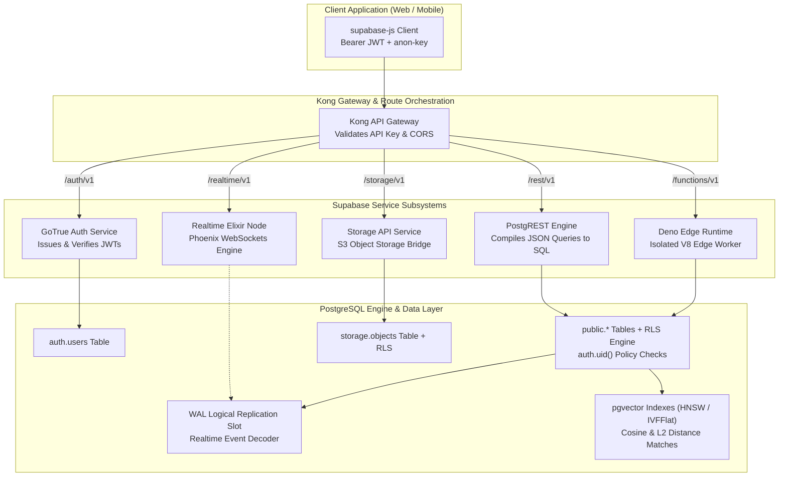

# Comprehensive Supabase & Modern Postgres Cloud Architecture Masterclass

[](https://supabase.com/)
[](https://www.postgresql.org/)
[](https://github.com/supabase/auth)
[](https://postgrest.org/)
[](https://github.com/pgvector/pgvector)
[](LICENSE)

> An enterprise-grade architectural masterclass on Supabase: PostgreSQL core primitives, Row Level Security (RLS) isolation, GoTrue identity architecture, PostgREST query compilation, Elixir Phoenix Realtime engine, S3-compatible Storage security, Deno Edge Functions, and AI vector embeddings with `pgvector`.

---

## Executive Summary & Architectural Overview

Supabase is not an opaque proprietary backend platform; it is a modular, open-source orchestration layer built around **PostgreSQL**. Instead of abstracting developers away from the relational database behind a proprietary NoSQL layer, Supabase elevates PostgreSQL as the single source of truth. Every feature—from instant REST APIs via PostgREST, real-time WebSocket multiplexing via an Elixir WAL listener, user authentication via GoTrue, to file storage and vector similarity search—maps directly to native database constructs, table schemas, and SQL permissions.

```
+---------------------------------------------------------------------------------------------------+
|                                 SUPABASE ARCHITECTURAL TOPOLOGY                                   |
+---------------------------------------------------------------------------------------------------+
|  [Client Layer: Web / Mobile / Edge Application (supabase-js / SDKs)]                             |
+---------------------------------------------------------------------------------------------------+
                                           │ HTTPS / WSS
                                           ▼
+---------------------------------------------------------------------------------------------------+
|  [API Gateway & Reverse Proxy: Kong / Envoy]                                                      |
|    - TLS Termination, Rate Limiting, API Key Verification (anon key vs service_role)              |
+---------------------------------------------------------------------------------------------------+
       │                         │                        │                        │
       ▼                         ▼                        ▼                        ▼
+--------------+       +-------------------+    +--------------------+   +-------------------+
| GoTrue (Auth)|       | PostgREST (Data)  |    | Realtime (Elixir)  |   | Storage Engine    |
| - OAuth / OIDC|      | - Instant REST API|    | - Phoenix Channels |   | - S3 API Wrapper  |
| - JWT Issuer  |      | - SQL Transpiler  |    | - WAL Replication  |   | - Image Resizing  |
| - MFA / TOTP  |      | - Schema Cache    |    | - Broadcast/Pres.  |   | - storage.objects |
+--------------+       +-------------------+    +--------------------+   +-------------------+
       │                         │                        │                        │
       └─────────────────────────┼────────────────────────┴────────────────────────┘
                                 ▼
+---------------------------------------------------------------------------------------------------+
|  [PostgreSQL Database Core (Single Source of Truth)]                                              |
|    - Row Level Security (RLS): auth.uid(), auth.jwt()                                             |
|    - Extensions: pgvector, pg_net, pg_cron, pgcrypto, postgis                                    |
|    - Write-Ahead Logging (WAL): Logical Replication Slot (test_decoding / wal2json)              |
|    - Connection Pooling: Supavisor / PgBouncer (Transaction vs Session Mode)                      |
+---------------------------------------------------------------------------------------------------+
```

---

## Architectural Comparison Matrix

| Architectural Feature | Supabase (v2.x) | Firebase (Firestore) | AWS Amplify (AppSync) | Raw PostgreSQL + Prisma |
| :--- | :--- | :--- | :--- | :--- |
| **Database Engine** | Native PostgreSQL (Relational) | Cloud Firestore (NoSQL Doc) | DynamoDB / Aurora Serverless | Any relational DB |
| **Data Access Layer** | PostgREST (Auto SQL-to-REST) | Proprietary SDK / REST | GraphQL / DynamoDB client | Custom Express/NestJS API |
| **Security Mechanism** | Native SQL Row Level Security | Security Rules (custom DSL) | IAM / Cognito / VTL Resolvers| Custom middleware code |
| **Realtime Engine** | Elixir Phoenix (WAL Stream) | Proprietary client listeners | AppSync GraphQL Subscriptions | Custom Socket.io / Redis |
| **AI & Vector Search**| Native `pgvector` extension | Third-party (Pinecone / Vertex)| OpenSearch / Bedrock | Extension or separate vector DB |
| **Hosting Model** | Cloud or 100% Self-Hosted (Docker)| Cloud Only (Vendor Lock-in) | AWS Cloud Only | Fully Self-Managed |
| **Edge Functions** | Native Deno TypeScript | Cloud Functions (Node/Python) | AWS Lambda (Node/Python) | Node / Container instances |
| **Database Portability**| Standard pg_dump / SQL export | Proprietary export format | Proprietary DynamoDB export | Standard SQL tooling |

---

## Supabase Request & Data Flow Pipeline



---

## Comprehensive 10-Stage Curriculum

```
Stage 01: Supabase Architecture & The Open-Source Postgres Foundation
Stage 02: Relational Schema Modeling & PostgreSQL Database Primitives
Stage 03: Row Level Security (RLS) & Fine-Grained Access Control
Stage 04: Authentication Architecture (GoTrue, JWTs, OAuth & MFA)
Stage 05: Database Functions, Triggers, Webhooks & `pg_net`
Stage 06: Realtime Engine: Postgres Changes, Broadcast & Presence
Stage 07: Supabase Storage Architecture & Object Level Security
Stage 08: Serverless Deno Edge Functions & Service-Role Isolation
Stage 09: Vector Embeddings & Similarity Search with `pgvector`
Stage 10: Local Development CLI, Migrations, Supavisor & Production Scaling
```

---

### Stage 1: Supabase Architecture & The Open-Source Postgres Foundation

Supabase is composed of decoupled, specialized open-source tools orchestrated to deliver a cohesive Backend-as-a-Service (BaaS).

#### 1. Core Architectural Subsystems
- **PostgreSQL**: The foundation. Uncompromised relational storage with foreign keys, JSONB, transaction isolation levels, and ACID guarantees.
- **PostgREST**: A standalone web server that reads your PostgreSQL schema and automatically generates a robust, OpenAPI-compliant RESTful interface. Query parameters like `?select=id,title,authors(name)&status=eq.published` are compiled directly into a single SQL statement.
- **GoTrue**: A Go-based identity server that handles user signups, email confirmations, password resets, multi-factor authentication (MFA), and OAuth providers, issuing signed JSON Web Tokens (JWTs).
- **Realtime**: An Elixir server built on Phoenix Channels. It attaches to PostgreSQL's logical replication stream, transforms database mutations (INSERT, UPDATE, DELETE) into WebSocket messages, and handles ephemeral broadcast messaging and user presence.
- **Supabase Storage**: A RESTful file management service backed by S3-compatible object storage, utilizing PostgreSQL tables (`storage.buckets`, `storage.objects`) to govern access control through RLS.

---

### Stage 2: Relational Schema Modeling & PostgreSQL Database Primitives

Building on Supabase starts with idiomatic PostgreSQL schema design.

#### 1. Multi-Tenant Enterprise Schema Specification
```sql
-- Create custom enum types
CREATE TYPE user_role AS ENUM ('owner', 'admin', 'member', 'guest');
CREATE TYPE subscription_tier AS ENUM ('free', 'pro', 'enterprise');

-- Organizations Table (Tenant Isolation Anchor)
CREATE TABLE organizations (
    id UUID PRIMARY KEY DEFAULT gen_random_uuid(),
    name TEXT NOT NULL CHECK (char_length(name) >= 2),
    slug TEXT NOT NULL UNIQUE,
    tier subscription_tier NOT NULL DEFAULT 'free',
    metadata JSONB DEFAULT '{}'::jsonb,
    created_at TIMESTAMPTZ NOT NULL DEFAULT timezone('utc'::text, now()),
    updated_at TIMESTAMPTZ NOT NULL DEFAULT timezone('utc'::text, now())
);

-- Organization Memberships
CREATE TABLE organization_members (
    id UUID PRIMARY KEY DEFAULT gen_random_uuid(),
    organization_id UUID NOT NULL REFERENCES organizations(id) ON DELETE CASCADE,
    user_id UUID NOT NULL REFERENCES auth.users(id) ON DELETE CASCADE,
    role user_role NOT NULL DEFAULT 'member',
    joined_at TIMESTAMPTZ NOT NULL DEFAULT timezone('utc'::text, now()),
    UNIQUE(organization_id, user_id)
);

-- Workspace Projects
CREATE TABLE projects (
    id UUID PRIMARY KEY DEFAULT gen_random_uuid(),
    organization_id UUID NOT NULL REFERENCES organizations(id) ON DELETE CASCADE,
    name TEXT NOT NULL,
    description TEXT,
    is_archived BOOLEAN NOT NULL DEFAULT false,
    created_by UUID REFERENCES auth.users(id) ON DELETE SET NULL,
    created_at TIMESTAMPTZ NOT NULL DEFAULT timezone('utc'::text, now())
);

-- Optimized B-Tree Indices for Foreign Key Traversals
CREATE INDEX idx_org_members_user ON organization_members(user_id);
CREATE INDEX idx_projects_org ON projects(organization_id);
CREATE INDEX idx_projects_active ON projects(organization_id) WHERE is_archived = false;
```

---

### Stage 3: Row Level Security (RLS) & Fine-Grained Access Control

Row Level Security is Supabase's primary security boundary. When enabled, queries without explicit matching policies return zero rows.

#### 1. Enabling RLS and Understanding JWT Injection
PostgREST sets the PostgreSQL session config on every request:
```sql
-- PostgREST sets these variables per request:
-- SET LOCAL request.jwt.claim.sub = 'user-uuid';
-- SET LOCAL request.jwt.claim.role = 'authenticated';
```
Supabase provides built-in helper functions:
- `auth.uid()`: Extracts the `sub` claim (user UUID) from the request JWT.
- `auth.jwt()`: Returns the complete decoded JWT as a JSONB object.
- `auth.role()`: Returns the role claim (`anon`, `authenticated`, or `service_role`).

#### 2. Writing Production-Grade Multi-Tenant RLS Policies
```sql
-- 1. Enable RLS on all sensitive tables
ALTER TABLE organizations ENABLE ROW LEVEL SECURITY;
ALTER TABLE organization_members ENABLE ROW LEVEL SECURITY;
ALTER TABLE projects ENABLE ROW LEVEL SECURITY;

-- 2. Organization Members Policies
-- Users can view member lists of organizations they belong to
CREATE POLICY "Members can view co-members"
    ON organization_members
    FOR SELECT
    TO authenticated
    USING (
        organization_id IN (
            SELECT om.organization_id 
            FROM organization_members om 
            WHERE om.user_id = auth.uid()
        )
    );

-- 3. Projects Table Policies
-- SELECT: Users can only view projects within their organizations
CREATE POLICY "Users can view projects in their organizations"
    ON projects
    FOR SELECT
    TO authenticated
    USING (
        EXISTS (
            SELECT 1 
            FROM organization_members om
            WHERE om.organization_id = projects.organization_id
              AND om.user_id = auth.uid()
        )
    );

-- INSERT: Only owners and admins can create new projects
CREATE POLICY "Admins and owners can create projects"
    ON projects
    FOR INSERT
    TO authenticated
    WITH CHECK (
        EXISTS (
            SELECT 1 
            FROM organization_members om
            WHERE om.organization_id = projects.organization_id
              AND om.user_id = auth.uid()
              AND om.role IN ('owner', 'admin')
        )
    );

-- UPDATE: Only owners and admins can modify projects
CREATE POLICY "Admins and owners can update projects"
    ON projects
    FOR UPDATE
    TO authenticated
    USING (
        EXISTS (
            SELECT 1 
            FROM organization_members om
            WHERE om.organization_id = projects.organization_id
              AND om.user_id = auth.uid()
              AND om.role IN ('owner', 'admin')
        )
    )
    WITH CHECK (
        EXISTS (
            SELECT 1 
            FROM organization_members om
            WHERE om.organization_id = projects.organization_id
              AND om.user_id = auth.uid()
              AND om.role IN ('owner', 'admin')
        )
    );

-- DELETE: Only owners can delete projects
CREATE POLICY "Only owners can delete projects"
    ON projects
    FOR DELETE
    TO authenticated
    USING (
        EXISTS (
            SELECT 1 
            FROM organization_members om
            WHERE om.organization_id = projects.organization_id
              AND om.user_id = auth.uid()
              AND om.role = 'owner'
        )
    );
```

---

### Stage 4: Authentication Architecture (GoTrue, JWTs, OAuth & MFA)

GoTrue issues signed RS256/HS256 JWTs and maintains user identities in the private `auth.users` table.

#### 1. Client-Side Authentication Flow (TypeScript)
```typescript
import { createClient } from "@supabase/supabase-js";

const supabaseUrl = process.env.NEXT_PUBLIC_SUPABASE_URL!;
const supabaseAnonKey = process.env.NEXT_PUBLIC_SUPABASE_ANON_KEY!;

export const supabase = createClient(supabaseUrl, supabaseAnonKey, {
  auth: {
    persistSession: true,
    autoRefreshToken: true,
    detectSessionInUrl: true,
    flowType: "pkce" // Proof Key for Code Exchange (Essential for Mobile/SPA security)
  }
});

// 1. Passwordless Magic Link Login
export async function signInWithMagicLink(email: string) {
  const { data, error } = await supabase.auth.signInWithOtp({
    email,
    options: {
      emailRedirectTo: "https://enterprise.app/auth/callback"
    }
  });
  if (error) throw error;
  return data;
}

// 2. Enterprise OAuth / Google Sign-In with PKCE
export async function signInWithGoogle() {
  const { data, error } = await supabase.auth.signInWithOAuth({
    provider: "google",
    options: {
      redirectTo: "https://enterprise.app/auth/callback",
      queryParams: {
        access_type: "offline",
        prompt: "consent"
      }
    }
  });
  if (error) throw error;
  return data;
}

// 3. Multi-Factor Authentication (MFA / TOTP) Enrollment
export async function enrollMFA() {
  const { data, error } = await supabase.auth.mfa.enroll({
    factorType: "totp",
    issuer: "Enterprise Cloud"
  });
  if (error) throw error;
  // data contains: { id, totp: { qr_code, secret, uri } }
  return data;
}
```

---

### Stage 5: Database Functions, Triggers, Webhooks & `pg_net`

Because PostgreSQL is the engine, business logic can run transactionally in the database without network roundtrips.

#### 1. Automatic User Profile Creation via PostgreSQL Trigger
```sql
-- Public profiles table mirroring auth.users
CREATE TABLE profiles (
    id UUID PRIMARY KEY REFERENCES auth.users(id) ON DELETE CASCADE,
    display_name TEXT,
    avatar_url TEXT,
    created_at TIMESTAMPTZ NOT NULL DEFAULT now()
);

-- Function executed by trigger
CREATE OR REPLACE FUNCTION public.handle_new_user()
RETURNS TRIGGER 
LANGUAGE plpgsql 
SECURITY DEFINER -- Runs with elevated permissions of function creator
SET search_path = public
AS $$
BEGIN
    INSERT INTO public.profiles (id, display_name, avatar_url)
    VALUES (
        NEW.id,
        COALESCE(NEW.raw_user_meta_data->>'full_name', NEW.raw_user_meta_data->>'name', 'Anonymous User'),
        NEW.raw_user_meta_data->>'avatar_url'
    );
    RETURN NEW;
END;
$$;

-- Trigger attached to auth.users table
CREATE OR REPLACE TRIGGER on_auth_user_created
    AFTER INSERT ON auth.users
    FOR EACH ROW EXECUTE FUNCTION public.handle_new_user();
```

#### 2. Asynchronous Webhooks with `pg_net`
The `pg_net` extension allows PostgreSQL to make non-blocking HTTP requests asynchronously inside transactions:
```sql
CREATE EXTENSION IF NOT EXISTS pg_net WITH SCHEMA extensions;

CREATE OR REPLACE FUNCTION notify_external_webhook()
RETURNS TRIGGER 
LANGUAGE plpgsql
SECURITY DEFINER
AS $$
BEGIN
    PERFORM net.http_post(
        url := 'https://api.internal.service/webhooks/project-created',
        headers := jsonb_build_object(
            'Content-Type', 'application/json',
            'Authorization', 'Bearer ' || current_setting('app.webhook_secret', true)
        ),
        body := jsonb_build_object(
            'event', 'PROJECT_CREATED',
            'projectId', NEW.id,
            'organizationId', NEW.organization_id,
            'timestamp', now()
        )
    );
    RETURN NEW;
END;
$$;

CREATE TRIGGER trigger_project_webhook
    AFTER INSERT ON projects
    FOR EACH ROW EXECUTE FUNCTION notify_external_webhook();
```

---

### Stage 6: Realtime Engine: Postgres Changes, Broadcast & Presence

The Supabase Realtime engine enables bidirectional client communication with three primary channels:

```
[ Supabase Realtime Channel ]
       ├── 1. Postgres Changes (Database WAL logical replication -> Client)
       ├── 2. Broadcast (Ephemeral Client-to-Client low-latency messaging)
       └── 3. Presence (Distributed state synchronization: who is online)
```

#### 1. Subscribing to Postgres Changes and Presence (TypeScript)
```typescript
import { supabase } from "./client";

// Create a stateful collaboration channel
const roomChannel = supabase.channel("room:project-dashboard", {
  config: {
    presence: { key: "current-user-session-id" },
    broadcast: { ack: true }
  }
});

// 1. Listen for database INSERT/UPDATE on projects table in real-time
roomChannel
  .on(
    "postgres_changes",
    {
      event: "*", // INSERT, UPDATE, DELETE
      schema: "public",
      table: "projects"
    },
    (payload) => {
      console.log("Database mutation received:", payload.eventType, payload.new);
    }
  )
  // 2. Broadcast ephemeral cursor movements
  .on("broadcast", { event: "cursor-move" }, (payload) => {
    console.log(`User ${payload.userId} moved cursor to:`, payload.coords);
  })
  // 3. Track collaborative presence state
  .on("presence", { event: "sync" }, () => {
    const newState = roomChannel.presenceState();
    console.log("Online participants:", newState);
  })
  .on("presence", { event: "join" }, ({ key, newPresences }) => {
    console.log("Member joined session:", key, newPresences);
  })
  .on("presence", { event: "leave" }, ({ key, leftPresences }) => {
    console.log("Member departed session:", key, leftPresences);
  })
  .subscribe(async (status) => {
    if (status === "SUBSCRIBED") {
      // Announce current user presence
      await roomChannel.track({
        userId: "user_456",
        userName: "Sarah Jenkins",
        onlineAt: new Date().toISOString()
      });
    }
  });

// Broadcast client event
export function broadcastCursor(x: number, y: number) {
  roomChannel.send({
    type: "broadcast",
    event: "cursor-move",
    payload: { userId: "user_456", coords: { x, y } }
  });
}
```

---

### Stage 7: Supabase Storage Architecture & Object Level Security

Supabase Storage integrates with PostgreSQL so that file uploads are governed by the same Row Level Security engine as database records.

#### 1. Configuring Storage Buckets and RLS Security Policies
```sql
-- 1. Create a secure private bucket for enterprise contracts
INSERT INTO storage.buckets (id, name, public, file_size_limit, allowed_mime_types)
VALUES (
    'contracts',
    'contracts',
    false, -- Private bucket: Requires signed URLs or authenticated RLS access
    52428800, -- 50 MB limit
    ARRAY['application/pdf', 'image/png']
);

-- 2. Allow authenticated users to view contracts if they belong to the organization
CREATE POLICY "Users can download contracts for their organization"
    ON storage.objects
    FOR SELECT
    TO authenticated
    USING (
        bucket_id = 'contracts' AND
        (storage.foldername(name))[1] IN (
            SELECT om.organization_id::text
            FROM organization_members om
            WHERE om.user_id = auth.uid()
        )
    );

-- 3. Allow only admins and owners to upload files into organization folder
CREATE POLICY "Admins can upload contracts"
    ON storage.objects
    FOR INSERT
    TO authenticated
    WITH CHECK (
        bucket_id = 'contracts' AND
        EXISTS (
            SELECT 1 
            FROM organization_members om
            WHERE om.organization_id::text = (storage.foldername(name))[1]
              AND om.user_id = auth.uid()
              AND om.role IN ('owner', 'admin')
        )
    );
```

#### 2. Uploading and Downloading via JavaScript SDK
```typescript
import { supabase } from "./client";

export async function uploadContract(orgId: string, file: File) {
  const filePath = `${orgId}/${crypto.randomUUID()}-${file.name}`;

  // 1. Secure upload respecting RLS
  const { data, error } = await supabase.storage
    .from("contracts")
    .upload(filePath, file, {
      cacheControl: "3600",
      upsert: false
    });

  if (error) throw error;

  // 2. Generate time-limited signed URL for private document download
  const { data: signedData, error: signError } = await supabase.storage
    .from("contracts")
    .createSignedUrl(filePath, 60); // Valid for 60 seconds

  if (signError) throw signError;
  return signedData.signedUrl;
}
```

---

### Stage 8: Serverless Deno Edge Functions & Service-Role Isolation

Edge Functions run globally distributed on Deno isolates, executing TypeScript near clients with negligible cold-start latency.

#### 1. Production Edge Function with Stripe Webhook & Service Role (`index.ts`)
```typescript
// supabase/functions/stripe-webhook/index.ts
import { serve } from "https://deno.land/std@0.177.0/http/server.ts";
import { createClient } from "https://esm.sh/@supabase/supabase-js@2.39.0";
import Stripe from "https://esm.sh/stripe@14.0.0";

const stripe = new Stripe(Deno.env.get("STRIPE_SECRET_KEY")!, {
  apiVersion: "2023-10-16",
  httpClient: Stripe.createFetchHttpClient()
});

const endpointSecret = Deno.env.get("STRIPE_WEBHOOK_SIGNING_SECRET")!;

serve(async (req: Request) => {
  const signature = req.headers.get("stripe-signature");
  if (!signature) {
    return new Response("Missing signature", { status: 400 });
  }

  try {
    const rawBody = await req.text();
    const event = await stripe.webhooks.constructEventAsync(rawBody, signature, endpointSecret);

    if (event.type === "checkout.session.completed") {
      const session = event.data.object as Stripe.Checkout.Session;
      const orgId = session.metadata?.organizationId;

      // Initialize Supabase Admin Client using service_role key to bypass RLS safely in backend
      const supabaseAdmin = createClient(
        Deno.env.get("SUPABASE_URL")!,
        Deno.env.get("SUPABASE_SERVICE_ROLE_KEY")!,
        { auth: { persistSession: false } }
      );

      // Upgrade organization tier
      const { error } = await supabaseAdmin
        .from("organizations")
        .update({ tier: "pro", updated_at: new Date().toISOString() })
        .eq("id", orgId);

      if (error) throw error;
      console.log(`Successfully upgraded organization ${orgId} to Pro tier.`);
    }

    return new Response(JSON.stringify({ received: true }), {
      headers: { "Content-Type": "application/json" },
      status: 200
    });
  } catch (err: any) {
    console.error("Webhook processing error:", err.message);
    return new Response(`Webhook Error: ${err.message}`, { status: 400 });
  }
});
```

---

### Stage 9: Vector Embeddings & Similarity Search with `pgvector`

Supabase turns PostgreSQL into a high-performance vector database using the `pgvector` extension.

#### 1. Schema, Vectors, and Index Types
```sql
-- Enable pgvector extension
CREATE EXTENSION IF NOT EXISTS vector WITH SCHEMA extensions;

-- Documents Table with 1536-dimensional OpenAI embeddings
CREATE TABLE documents (
    id UUID PRIMARY KEY DEFAULT gen_random_uuid(),
    organization_id UUID NOT NULL REFERENCES organizations(id) ON DELETE CASCADE,
    title TEXT NOT NULL,
    content TEXT NOT NULL,
    embedding vector(1536) NOT NULL, -- 1536 dimensions for text-embedding-3-small
    created_at TIMESTAMPTZ DEFAULT now()
);

-- Create HNSW (Hierarchical Navigable Small World) Index for ultra-fast approximate nearest neighbor search
-- Cosine distance operator is <=>
CREATE INDEX idx_documents_hnsw_cosine 
    ON documents 
    USING hnsw (embedding vector_cosine_ops)
    WITH (m = 16, ef_construction = 64);
```

#### 2. Vector Similarity Search Function (RPC)
```sql
CREATE OR REPLACE FUNCTION match_documents(
    query_embedding vector(1536),
    match_threshold FLOAT,
    match_count INT,
    target_org_id UUID
)
RETURNS TABLE (
    id UUID,
    title TEXT,
    content TEXT,
    similarity FLOAT
)
LANGUAGE plpgsql
STABLE
AS $$
BEGIN
    RETURN QUERY
    SELECT
        d.id,
        d.title,
        d.content,
        1 - (d.embedding <=> query_embedding) AS similarity
    FROM documents d
    WHERE d.organization_id = target_org_id
      AND 1 - (d.embedding <=> query_embedding) > match_threshold
    ORDER BY d.embedding <=> query_embedding ASC
    LIMIT match_count;
END;
$$;
```

#### 3. Invoking Vector RPC via Supabase JavaScript SDK
```typescript
import { supabase } from "./client";

export async function searchKnowledgeBase(queryEmbedding: number[], orgId: string) {
  const { data, error } = await supabase.rpc("match_documents", {
    query_embedding: queryEmbedding,
    match_threshold: 0.78,
    match_count: 5,
    target_org_id: orgId
  });

  if (error) throw error;
  return data;
}
```

---

### Stage 10: Local Development CLI, Migrations, Supavisor & Production Scaling

Production operations require reproducible migrations, automated CI/CD pipelines, and high-concurrency connection pooling.

#### 1. Supabase Local Development Workflow
```bash
# Install CLI and initialize local project
supabase init

# Spin up local Docker-based Supabase stack (Postgres, GoTrue, PostgREST, Realtime, Inbucket)
supabase start

# Create a new version-controlled SQL migration
supabase migration new create_knowledge_base_tables

# Apply migrations locally
supabase db reset

# Generate TypeScript types automatically from current database schema
supabase gen types typescript --local > src/types/database.ts

# Link local repository to production project and push migrations
supabase link --project-ref your-project-id
supabase db push
```

#### 2. Supavisor Connection Pooling Architecture
PostgreSQL uses a process-based connection model. Each direct connection consumes 5MB–10MB of RAM. At thousands of concurrent serverless functions, PostgreSQL exhausts available connections.

- **Supavisor**: A cloud-native connection pooler engineered in Elixir by Supabase, replacing PgBouncer.
- **Session Mode (Port 5432)**: Direct connection behavior, supports prepared statements, ideal for persistent server environments (Node.js, containers).
- **Transaction Mode (Port 6543)**: Connection is checked out only during an active transaction, enabling tens of thousands of concurrent serverless requests (Vercel, AWS Lambda, Deno).

---

## Production Blueprint: Enterprise Knowledge Base & AI Agent Platform

The following end-to-end blueprint implements a secure, multi-tenant document ingestion and semantic search system with full RLS, automatic timestamp triggers, and RPC queries.

```sql
-- migration.sql: Complete Enterprise Knowledge Base Schema
BEGIN;

-- 1. Enable required extensions
CREATE EXTENSION IF NOT EXISTS "uuid-ossp";
CREATE EXTENSION IF NOT EXISTS vector WITH SCHEMA extensions;

-- 2. Knowledge Articles Table
CREATE TABLE articles (
    id UUID PRIMARY KEY DEFAULT uuid_generate_v4(),
    organization_id UUID NOT NULL,
    author_id UUID NOT NULL REFERENCES auth.users(id),
    title VARCHAR(255) NOT NULL,
    slug VARCHAR(255) NOT NULL,
    markdown_body TEXT NOT NULL,
    embedding vector(1536),
    is_published BOOLEAN NOT NULL DEFAULT false,
    view_count BIGINT NOT NULL DEFAULT 0,
    created_at TIMESTAMPTZ NOT NULL DEFAULT timezone('utc', now()),
    updated_at TIMESTAMPTZ NOT NULL DEFAULT timezone('utc', now()),
    UNIQUE(organization_id, slug)
);

-- 3. Automatic updated_at Trigger
CREATE OR REPLACE FUNCTION set_updated_at_column()
RETURNS TRIGGER AS $$
BEGIN
    NEW.updated_at = timezone('utc', now());
    RETURN NEW;
END;
$$ LANGUAGE plpgsql;

CREATE TRIGGER trigger_articles_updated_at
    BEFORE UPDATE ON articles
    FOR EACH ROW EXECUTE FUNCTION set_updated_at_column();

-- 4. Enable Row Level Security
ALTER TABLE articles ENABLE ROW LEVEL SECURITY;

-- 5. Strict RLS Policies
CREATE POLICY "Public articles readable by authenticated org members"
    ON articles
    FOR SELECT
    TO authenticated
    USING (
        is_published = true AND
        organization_id = (auth.jwt()->'app_metadata'->>'organization_id')::uuid
    );

CREATE POLICY "Authors and editors can insert articles"
    ON articles
    FOR INSERT
    TO authenticated
    WITH CHECK (
        author_id = auth.uid() AND
        organization_id = (auth.jwt()->'app_metadata'->>'organization_id')::uuid
    );

-- 6. HNSW Cosine Index for Vector Search
CREATE INDEX idx_articles_vector_hnsw 
    ON articles 
    USING hnsw (embedding vector_cosine_ops)
    WITH (m = 16, ef_construction = 64);

-- 7. Secure Semantic Search Stored Procedure
CREATE OR REPLACE FUNCTION search_knowledge_articles(
    query_vector vector(1536),
    similarity_cutoff FLOAT,
    max_results INT
)
RETURNS TABLE (
    article_id UUID,
    title VARCHAR(255),
    slug VARCHAR(255),
    snippet TEXT,
    similarity_score FLOAT
)
LANGUAGE plpgsql
SECURITY INVOKER -- Evaluates RLS policies of the caller!
AS $$
BEGIN
    RETURN QUERY
    SELECT 
        a.id,
        a.title,
        a.slug,
        substring(a.markdown_body from 1 for 200) AS snippet,
        1 - (a.embedding <=> query_vector) AS similarity_score
    FROM articles a
    WHERE 1 - (a.embedding <=> query_vector) >= similarity_cutoff
    ORDER BY a.embedding <=> query_vector ASC
    LIMIT max_results;
END;
$$;

COMMIT;
```

---

## Anti-Patterns & Common Production Pitfalls

```
+------------------------------------+---------------------------------------------------------------+
| ANTI-PATTERN                       | PRODUCTION-GRADE REMEDY                                       |
+------------------------------------+---------------------------------------------------------------+
| Exposing SUPABASE_SERVICE_ROLE_KEY | NEVER include the service_role key in frontend clients.       |
| in client-side applications        | It bypasses all RLS policies, creating critical vulnerabilities.|
|                                    |                                                               |
| Forgetting to enable RLS on newly  | Always execute ALTER TABLE x ENABLE ROW LEVEL SECURITY;       |
| created public schema tables       | Tables without RLS are completely accessible to the public!   |
|                                    |                                                               |
| Over-using SECURITY DEFINER on     | Use SECURITY INVOKER by default so RLS is respected. When    |
| PostgreSQL stored procedures       | using DEFINER, set search_path = public to avoid injection.   |
|                                    |                                                               |
| Direct database connections from   | Use Supavisor Transaction Pooler (port 6543) in serverless    |
| serverless lambdas without pooling | runtimes to prevent exhausting PostgreSQL connection limits.  |
|                                    |                                                               |
| Storing large base64 files directly| Store files in Supabase Storage and persist only the object   |
| inside database table columns      | key / file path inside PostgreSQL records.                    |
+------------------------------------+---------------------------------------------------------------+
```

---

## Advanced Architectural Interview Questions & Answers

### Q1: How does PostgREST introspect PostgreSQL schemas, and how does it prevent SQL injection vulnerabilities?
**Answer:**
PostgREST queries the PostgreSQL system catalog tables (`information_schema`, `pg_catalog`) at startup to construct an in-memory schema graph containing tables, views, columns, foreign keys, and stored procedures:
1. **Parameterized Queries**: Incoming HTTP parameters are never concatenated into raw SQL strings. Instead, PostgREST compiles HTTP requests into an Abstract Syntax Tree (AST) and generates single, parameterized SQL statements where client inputs are passed as bind parameters.
2. **CTE Compilation**: Deeply nested relational queries (e.g., `?select=id,name,orders(id,total,items(name))`) are compiled into a single Common Table Expression (CTE) utilizing `json_agg` and `json_build_object`. This eliminates N+1 query overhead by executing the query in a single database roundtrip.

---

### Q2: What is the architectural difference between `SECURITY DEFINER` and `SECURITY INVOKER` functions in PostgreSQL and Supabase?
**Answer:**
- **SECURITY INVOKER (Default)**: The function executes with the permissions and privileges of the user who calls it. All Row Level Security policies of the calling user are applied. This is the safest setting for user-facing RPC endpoints.
- **SECURITY DEFINER**: The function executes with the privileges of the database user who created the function (typically `postgres` or `supabase_admin`). It completely bypasses the caller's RLS policies.
- **Security Mitigation**: If `SECURITY DEFINER` must be used (e.g., creating a user profile in `auth.users` triggers), always explicitly specify `SET search_path = public, pg_temp;` to prevent search path hijacking attacks.

---

### Q3: How does the Supabase Realtime engine decode PostgreSQL mutations, and what are the performance implications on the database?
**Answer:**
The Realtime engine uses PostgreSQL Logical Decoding:
1. It connects to PostgreSQL using a logical replication slot (`wal2json` or `test_decoding`).
2. As transactions commit, PostgreSQL writes change records to the Write-Ahead Log (WAL).
3. The Elixir Realtime server reads this WAL stream, parses the mutations, and matches them against active client subscriptions.
4. **Performance Consideration**: If high-frequency bulk updates occur or clients subscribe to unindexed tables, the replication slot buffer can grow, consuming disk space. Best practice is to enable Realtime only on specific tables (`ALTER PUBLICATION supabase_realtime ADD TABLE x;`) rather than the entire database.

---

### Q4: Explain the differences between HNSW and IVFFlat index algorithms in `pgvector`. When should each be chosen?
**Answer:**
- **IVFFlat (Inverted File Flat)**:
  - Partitions vectors into Voronoi cells via k-means clustering. During search, only vectors in nearby centroids are examined.
  - Requires pre-training: you must build the index after populating data (`lists` parameter must be tuned).
  - Uses less memory (RAM) and builds faster, but yields lower recall and higher query latency under high scale.
- **HNSW (Hierarchical Navigable Small World)**:
  - Builds a multi-layer proximity graph where upper layers have long-distance skip links and bottom layers have dense local links.
  - Can be built incrementally on empty tables with zero pre-training.
  - Offers superior query recall and significantly lower search latency (sub-5ms) at the cost of higher memory consumption and longer initial build times. HNSW is recommended for production applications.

---

### Q5: How does Supavisor handle connection pooling in Transaction Mode vs Session Mode?
**Answer:**
- **Session Mode (Port 5432)**:
  - A client holds a dedicated physical PostgreSQL connection for the entire duration of the client connection.
  - Supports session-level features such as `LISTEN/NOTIFY`, temporary tables, and prepared statements.
  - Cannot scale beyond the database's physical connection ceiling (typically 100–500 connections).
- **Transaction Mode (Port 6543)**:
  - A physical PostgreSQL connection is assigned to a client only while an individual SQL transaction is executing. Once the transaction commits or rolls back, the connection returns to the pool immediately.
  - Allows thousands of concurrent serverless functions to share a small pool of 20–50 physical database connections.
  - Disallows session-level state modifications and persistent prepared statements.

---

### Q6: How does GoTrue handle the Proof Key for Code Exchange (PKCE) flow during OAuth sign-ins?
**Answer:**
In mobile apps and Single Page Applications (SPAs), storing an OAuth client secret is insecure because client code can be decompiled:
1. The client generates a cryptographic random string called a **Code Verifier** and computes its SHA-256 hash, called the **Code Challenge**.
2. The user initiates OAuth, sending the Code Challenge to GoTrue and the identity provider.
3. Upon authentication, the provider redirects back with an authorization code.
4. The client exchanges this code for a session token by sending the original Code Verifier. GoTrue verifies that `SHA256(Code Verifier) == Code Challenge`, ensuring authorization code interception attacks fail without exposing credentials.

---

### Q7: What are the security risks of using `auth.jwt()` inside Row Level Security policies, and how can they be mitigated?
**Answer:**
1. **Stale Claims**: JWTs are signed and stateless. If an administrator revokes a user's role or bans them in the database, the JWT remains technically valid until its expiration timestamp (typically 1 hour).
2. **Client Metadata Tampering**: Custom attributes stored in `user_metadata` can be edited by users via `supabase.auth.updateUser()`. If an RLS policy references `auth.jwt()->'user_metadata'->>'role'`, a malicious user can elevate their privileges to `admin`.
3. **Mitigation**: Critical role checks should either query a trusted relational table (`organization_members`) or read strictly from `app_metadata`, which can only be modified via the Supabase Service Role API.

---

### Q8: How does PostgREST determine the appropriate HTTP response code for database errors?
**Answer:**
PostgREST maps native PostgreSQL SQLSTATE error codes to HTTP status codes:
- `23505` (unique_violation) $	o$ `409 Conflict`
- `23503` (foreign_key_violation) $	o$ `409 Conflict`
- `42P01` (undefined_table) $	o$ `404 Not Found`
- `42501` (insufficient_privilege / RLS violation on INSERT/UPDATE) $	o$ `403 Forbidden` or `404 Not Found`
- `PGRST116` (JSON object requested via `.single()` but returned 0 or >1 rows) $	o$ `406 Not Acceptable` or `404 Not Found`.

---

### Q9: How can developers optimize slow Row Level Security (RLS) policies that perform cross-table subqueries?
**Answer:**
1. **Wrap in Subqueries with `SELECT 1`**: Instead of `IN (SELECT org_id FROM ...)`, use `EXISTS (SELECT 1 FROM ... WHERE org_id = table.org_id AND user_id = auth.uid())`.
2. **Index Supporting Foreign Keys**: Ensure all columns referenced in the RLS `USING` clause (e.g., `user_id`, `organization_id`) have explicit B-tree indexes.
3. **Use Stable Wrapper Functions**: Wrap complex permission lookups in PostgreSQL functions marked `STABLE` or `SECURITY DEFINER`. PostgreSQL can cache the result of `STABLE` functions within the same statement, preventing per-row recalculation.

---

### Q10: How does Supabase Storage manage image optimization and transformations on the fly?
**Answer:**
Supabase Storage integrates a dedicated image transformation proxy:
1. When requesting an asset with query parameters (e.g., `/render/image/public/bucket/img.jpg?width=500&height=300&quality=80`), the request routes through an image transformation worker.
2. The worker retrieves the original object from S3 storage, resizes and transcodes the image (converting to modern formats like WebP or AVIF), and streams the result back.
3. The transformed image is cached at the edge CDN (Cloudflare), ensuring subsequent requests avoid repeat processing and origin egress fees.

---

## Comprehensive Supabase CLI & JS SDK Cheatsheet

### 1. Supabase CLI Command Matrix
```bash
supabase init                 # Initialize new Supabase project configuration
supabase start                # Start local development Docker stack
supabase stop                 # Stop local development environment
supabase status               # View local container endpoints and API keys
supabase db diff -f migration # Generate migration file from local database schema diff
supabase db reset             # Reset local database and run all migrations from scratch
supabase migration new <name> # Create empty version-controlled migration file
supabase gen types typescript # Generate TypeScript database interfaces
supabase functions new <name> # Create new Deno Edge Function boilerplate
supabase functions serve      # Run Edge Functions locally with hot-reloading
```

### 2. Client Initialization & Basic CRUD
```typescript
import { createClient } from "@supabase/supabase-js";
import { Database } from "./types/database";

const supabase = createClient<Database>(SUPABASE_URL, SUPABASE_ANON_KEY);

// SELECT with relational joining and filtering
const { data, error } = await supabase
  .from("projects")
  .select(`
    id,
    name,
    organization:organizations(id, name, tier),
    members:organization_members(role, user:profiles(display_name))
  `)
  .eq("is_archived", false)
  .order("created_at", { ascending: false })
  .range(0, 19);

// INSERT record
const { data: newProject, error: insertError } = await supabase
  .from("projects")
  .insert({ name: "Alpha Launch", organization_id: "org-uuid" })
  .select()
  .single();

// UPDATE record
const { data: updated, error: updateError } = await supabase
  .from("projects")
  .update({ is_archived: true })
  .eq("id", "project-uuid");

// DELETE record
const { error: deleteError } = await supabase
  .from("projects")
  .delete()
  .eq("id", "project-uuid");
```

### 3. Authentication SDK Operations
```typescript
// Email Signup
const { data, error } = await supabase.auth.signUp({
  email: "developer@company.com",
  password: "SecurePassword123!",
  options: { data: { full_name: "Alex Rivera" } }
});

// Sign In with Password
const { data: session, error: loginError } = await supabase.auth.signInWithPassword({
  email: "developer@company.com",
  password: "SecurePassword123!"
});

// Sign Out
await supabase.auth.signOut();

// Auth State Change Listener
supabase.auth.onAuthStateChange((event, session) => {
  console.log("Auth Event:", event, "User:", session?.user?.id);
});
```

### 4. Storage Operations
```typescript
// Upload File
const { data, error } = await supabase.storage
  .from("avatars")
  .upload("user-1/profile.png", fileBlob, { upsert: true });

// Get Public URL
const { data: { publicUrl } } = supabase.storage
  .from("public-assets")
  .getPublicUrl("logo.png");

// Create Signed Download URL (Private Bucket)
const { data: signed, error: signError } = await supabase.storage
  .from("contracts")
  .createSignedUrl("confidential.pdf", 300);
```

---

## Conclusion & Recommended Next Steps

Supabase provides the architectural power and durability of PostgreSQL enhanced by an enterprise-grade suite of real-time, identity, storage, and AI extensions.

To continue advancing your full-stack and cloud infrastructure mastery:
1. Explore Google Firebase and Firestore document data modeling in [learn-firebase](https://github.com/TheLearningHubOrg/learn-firebase).
2. Master modern edge runtime systems in [learn-deno](https://github.com/TheLearningHubOrg/learn-deno).
3. Deepen your containerization and cloud orchestration skills in [learn-docker](https://github.com/TheLearningHubOrg/learn-docker).
